# Hybrid Identity: Active Directory on Azure Synced to Microsoft Entra ID

**Status:** ✅ Built and tested

## Video Walkthrough

> 🎥 Loom walkthrough coming soon

## Project Overview

Most enterprises still run on-premises Active Directory as the source of truth for who works there. Employees sign in to Windows and file shares with it, and they need the same identity for Microsoft 365, SaaS apps, and Azure. If those two directories drift apart, people end up with two passwords, admins create accounts twice, and a terminated employee can keep cloud access long after their AD account is disabled.

In this lab I built an Active Directory domain from scratch on an Azure VM, administered and hardened it like a production domain, then connected it to Microsoft Entra ID with Entra Cloud Sync. The domain has a tiered admin model, delegated helpdesk permissions, domain and fine-grained password policies, a domain controller audit policy, Protected Users, and the AD Recycle Bin. Sync is scoped to employee and group OUs only, so admin and service accounts never reach the cloud. Password hash sync lets employees sign in to cloud apps with their AD password, and disabling a user in AD blocks their cloud sign-in too.

### Skills Demonstrated

- **Active Directory** engineering: forest and domain creation, AD-integrated DNS, OU design
- **Tiered administration**: separate Tier 0 admin accounts, never a daily-use account
- **Delegation of control**: least-privilege helpdesk password resets scoped to one OU
- **Password policy**: domain-level policy plus a **fine-grained password policy** for admins
- **Group Policy**: an advanced audit policy linked to the Domain Controllers OU
- **AD security**: Protected Users, AD Recycle Bin, KDS root key for gMSAs
- **Hybrid identity** with **Microsoft Entra Cloud Sync** and **password hash sync**
- **Scoped synchronization**: deciding which identities exist in the cloud
- Joiner-mover-leaver across hybrid identity: a disable in AD flows to Entra ID
- Secure-by-default Azure infrastructure with Terraform: Bastion-only access, no public IP on the DC

## Architecture Diagram

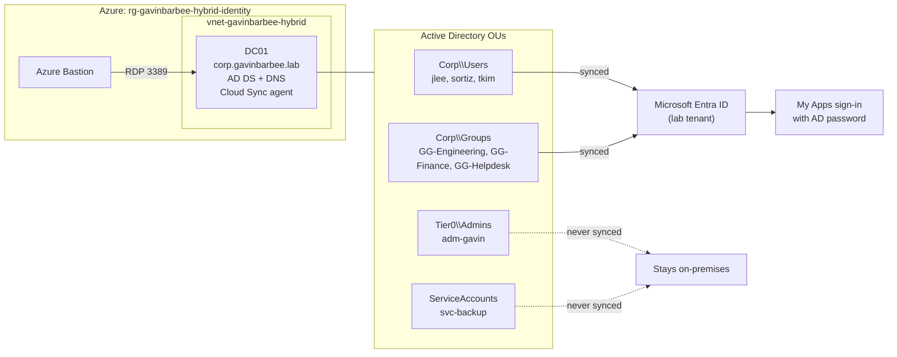

## Prerequisites

- An Azure subscription with quota for 2 vCPUs in the DALDSv7 family in East US 2 (or Central US)
- An Entra ID lab tenant I control, with a Global Administrator account (`gavinbarbee-admin@<tenant>.onmicrosoft.com`)
- Windows + VS Code + PowerShell
- Azure CLI and Terraform installed

## Naming Conventions

| Object | Name |
| --- | --- |
| Resource group | `rg-gavinbarbee-hybrid-identity` |
| Virtual network | `vnet-gavinbarbee-hybrid` |
| DC subnet / NSG | `snet-gavinbarbee-dc` / `nsg-gavinbarbee-dc` |
| Bastion | `bas-gavinbarbee-hybrid` |
| Domain controller VM | `vm-gavinbarbee-dc01` (computer name `DC01`) |
| AD database disk | `disk-gavinbarbee-dc01-ntds` |
| AD domain | `corp.gavinbarbee.lab` (NetBIOS `GAVINBARBEE`) |
| Employees | `jlee`, `sortiz`, `tkim` |
| Tier 0 admin | `adm-gavin` |
| Service account | `svc-backup` |
| Groups | `GG-Engineering`, `GG-Finance`, `GG-Helpdesk`, `GG-Tier0-Admins` |
| Fine-grained password policy | `FGPP-Tier0-Admins` |
| Audit GPO | `GPO-DC-Audit-Policy` |

## Project Steps

### 1. Deploy the infrastructure

I checked vCPU quota in East US 2 first, then deployed with Terraform:

```powershell
az vm list-usage --location eastus2 -o table | Select-String "Total Regional vCPUs|DALDSv7"

cd terraform
Copy-Item terraform.tfvars.example terraform.tfvars   # then set subscription_id and location
terraform init
terraform plan "-out=main.tfplan"
terraform apply main.tfplan
```

This creates a VNet with a DC subnet and a Bastion subnet, an NSG that only allows RDP from the Bastion subnet, Azure Bastion, and a Windows Server 2022 VM (`Standard_D2alds_v7`) with a static private IP. The AD database gets its own data disk with host caching turned off, so AD writes are never held in a host cache. The VM's NIC points DNS at the DC itself, and a daily auto-shutdown keeps costs down.

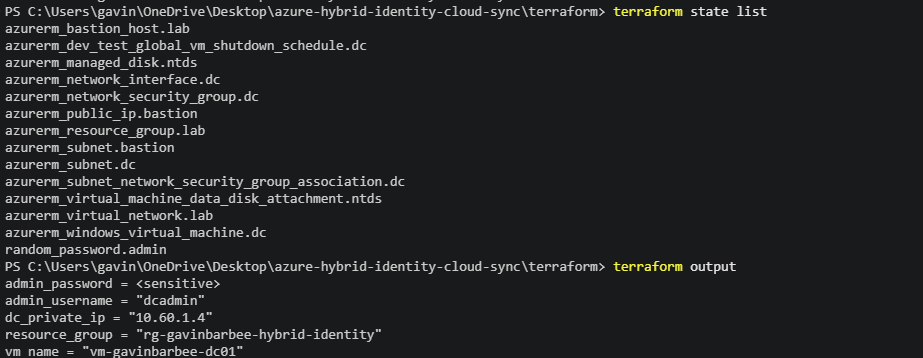

### 2. Promote the VM to a domain controller

I connected to `vm-gavinbarbee-dc01` through Bastion as `dcadmin` (password from `terraform output -raw admin_password`, read in the terminal only) and ran `scripts/01-promote-dc.ps1` in an elevated PowerShell session. It initializes the data disk as `F:`, installs the AD DS role, and creates the forest `corp.gavinbarbee.lab` with the database, logs, and SYSVOL on `F:`. The server reboots when promotion finishes.

After the reboot I signed back in as `GAVINBARBEE\dcadmin`. Promotion turned the VM's local admin into the domain's built-in Administrator.

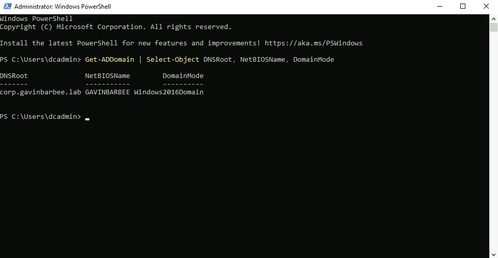

### 3. Build the OU structure and tiered accounts

`scripts/02-build-ad-structure.ps1` sets a DNS forwarder to Azure DNS (`168.63.129.16`) for internet lookups, then builds:

| OU | Contents | Syncs to Entra ID |
| --- | --- | --- |
| `Corp\Users` | `jlee` (Engineering), `sortiz` (Finance), `tkim` (Helpdesk) | Yes |
| `Corp\Groups` | `GG-Engineering`, `GG-Finance`, `GG-Helpdesk` | Yes |
| `Tier0\Admins` | `adm-gavin`, `GG-Tier0-Admins` | Never |
| `ServiceAccounts` | `svc-backup` | Never |

`adm-gavin` is my Tier 0 admin account and the only account I added to Domain Admins. Admin work happens in a separate account so a phished daily-use account can't become a Domain Admin.

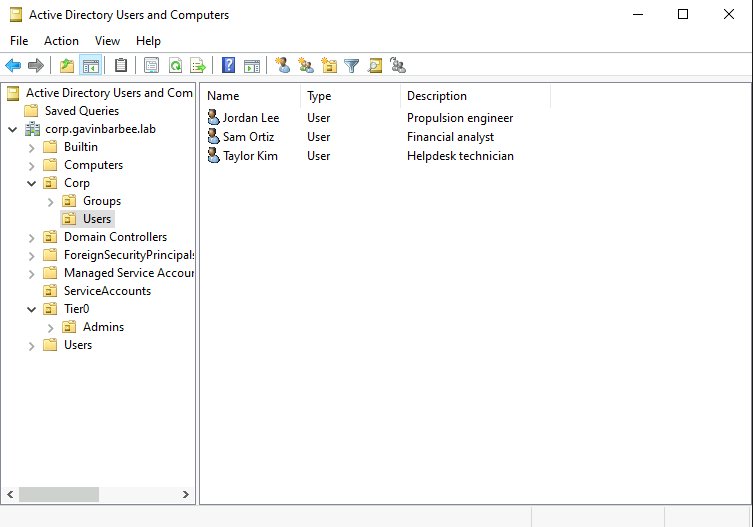

### 4. Harden the domain

`scripts/03-harden-ad.ps1` applies the rest of the configuration:

- **Delegation of control:** `GG-Helpdesk` can reset passwords, force a password change at next sign-in, and unlock accounts, but only for users in `Corp\Users`.
- **Domain password policy:** 14-character minimum, complexity, 24 remembered passwords, and lockout after 10 failed attempts for 15 minutes. For domain accounts, password and lockout settings only take effect at the domain level, which is why this is set on the domain rather than on an OU.
- **Fine-grained password policy:** `FGPP-Tier0-Admins` applies a 20-character minimum, 90-day expiry, and lockout after 5 attempts to `GG-Tier0-Admins`. Fine-grained policies are how one domain gets different password rules for different groups.
- **Audit GPO:** creates `GPO-DC-Audit-Policy` and links it to the Domain Controllers OU (configured in step 5).
- **Protected Users:** adds `adm-gavin`, which blocks NTLM, weak Kerberos encryption, and credential caching for that account.
- **AD Recycle Bin:** enabled for the forest.
- **KDS root key:** created so the Cloud Sync agent can create its group managed service account.

```powershell
Get-ADUserResultantPasswordPolicy -Identity adm-gavin
```

This confirms `adm-gavin` gets the fine-grained policy instead of the domain policy.

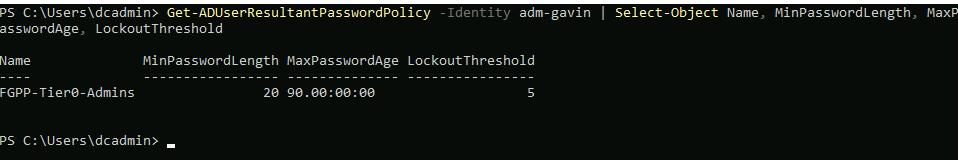

### 5. Configure the domain controller audit policy

In Group Policy Management I edited `GPO-DC-Audit-Policy` under Computer Configuration → Policies → Windows Settings → Security Settings → Advanced Audit Policy Configuration:

| Category | Subcategory | Audit |
| --- | --- | --- |
| Account Logon | Credential Validation | Success, Failure |
| Account Logon | Kerberos Authentication Service | Success, Failure |
| Account Management | User Account Management | Success, Failure |
| Account Management | Security Group Management | Success, Failure |
| Logon/Logoff | Logon | Success, Failure |
| DS Access | Directory Service Changes | Success |

```powershell
gpupdate /force
auditpol /get /category:"Account Management"
auditpol /get /subcategory:"Credential Validation","Kerberos Authentication Service","Logon","Directory Service Changes"
```

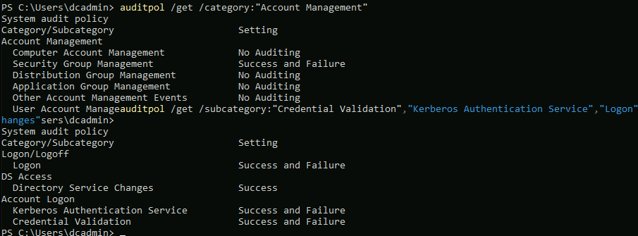

### 6. Test delegation and the Recycle Bin

To prove the delegation is scoped, I used `tkim`'s Helpdesk credentials to reset a password inside `Corp\Users`, then tried the same thing on the Tier 0 admin account:

```powershell
$tkim = Get-Credential GAVINBARBEE\tkim

Set-ADAccountPassword -Identity jlee -Reset -NewPassword (Read-Host -AsSecureString "new jlee password") -Credential $tkim   # succeeds
Set-ADAccountPassword -Identity adm-gavin -Reset -NewPassword (Read-Host -AsSecureString "attempt") -Credential $tkim       # Access is denied
```

Then I deleted a user and restored it from the Recycle Bin:

```powershell
Get-ADUser sortiz -Properties MemberOf | Select-Object -ExpandProperty MemberOf   # GG-Finance
Remove-ADUser sortiz -Confirm:$false
Get-ADObject -Filter 'samAccountName -eq "sortiz"' -IncludeDeletedObjects -Properties isDeleted | Select-Object Name, isDeleted
Get-ADObject -Filter 'samAccountName -eq "sortiz"' -IncludeDeletedObjects | Restore-ADObject
Get-ADUser sortiz -Properties MemberOf | Select-Object -ExpandProperty MemberOf   # GG-Finance again
```

`sortiz` came back with its `GG-Finance` membership intact, which a manually re-created account would have lost.

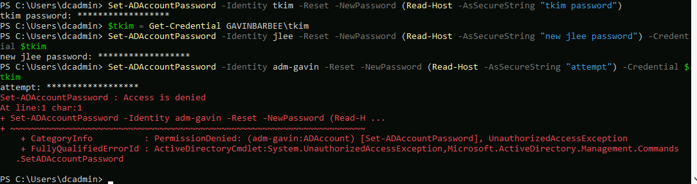
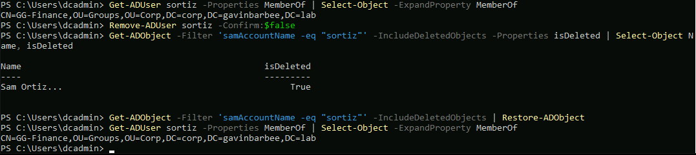

### 7. Install the Cloud Sync agent

On DC01 I opened Microsoft Edge, signed in to the Entra admin center as `gavinbarbee-admin`, and went to Entra ID → Entra Connect → Cloud sync → Agents → **Download on-premises agent**. I ran the installer, signed in with `gavinbarbee-admin`, chose to create a group managed service account, and provided `GAVINBARBEE\dcadmin` as the domain admin credential the installer needs.

The agent appeared as **Active** under Cloud sync → Agents.

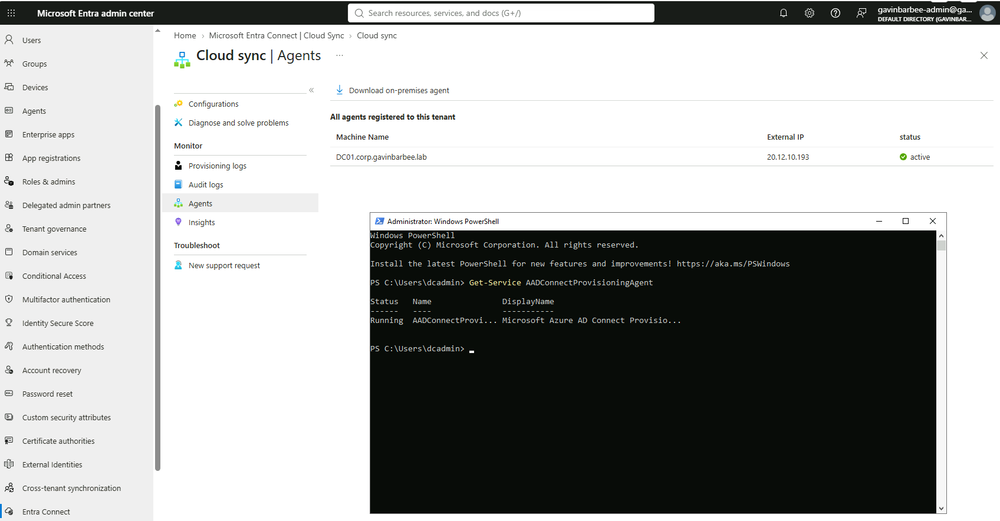

### 8. Configure scoped sync with password hash sync

Under Cloud sync → Configurations → **New configuration**, I chose AD to Microsoft Entra ID sync, selected `corp.gavinbarbee.lab`, and kept **password hash sync** enabled. A new configuration stays disabled until it's enabled, so before turning it on I opened Scoping filters and chose **Selected organizational units** and added only:

- `OU=Users,OU=Corp,DC=corp,DC=gavinbarbee,DC=lab`
- `OU=Groups,OU=Corp,DC=corp,DC=gavinbarbee,DC=lab`

I used **Provision on demand** on `jlee` first to confirm a single user synced cleanly, then enabled the configuration.

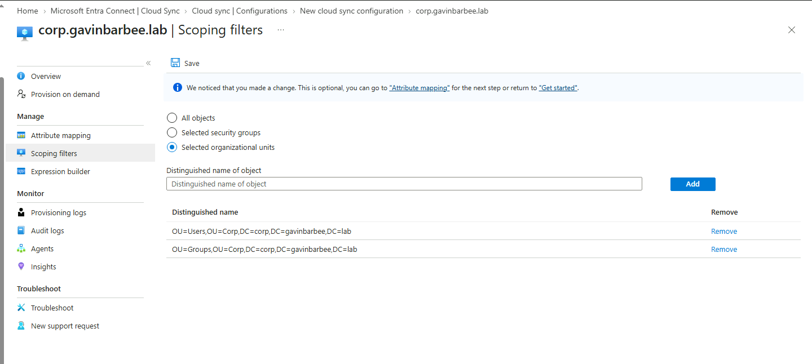
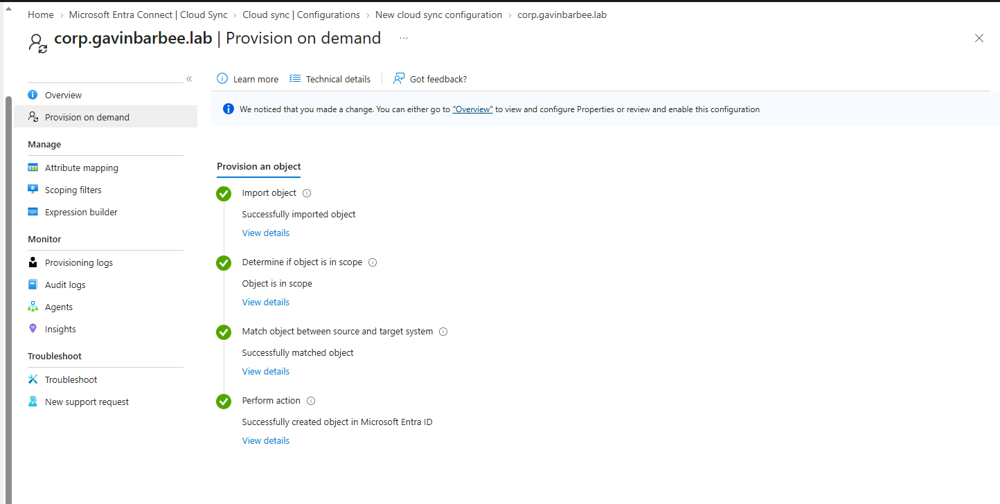

### 9. Verify the synced identities

- **Users and groups:** `jlee`, `sortiz`, `tkim`, and the three `GG-` groups appear in Entra ID with **On-premises sync enabled: Yes**. Because `corp.gavinbarbee.lab` isn't a verified domain in the tenant, their sign-in names became `<user>@<tenant>.onmicrosoft.com`.
- **Scoping worked:** `adm-gavin` and `svc-backup` don't exist in Entra ID.
- **Source of authority:** synced attributes like name and department are read-only in Entra ID, because AD owns them.
- **Password hash sync:** I signed in to **myapps.microsoft.com** as `jlee` with the AD password.

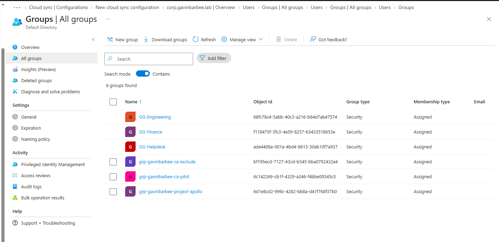
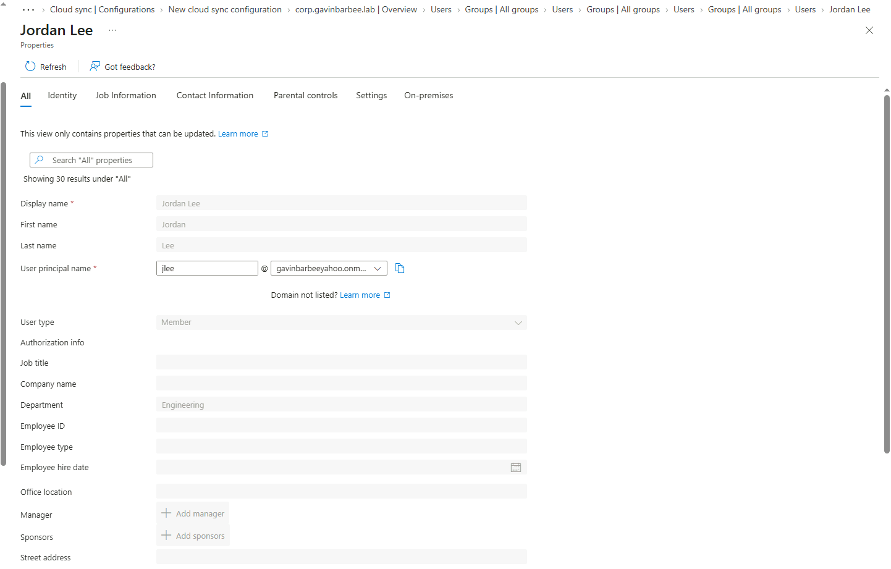
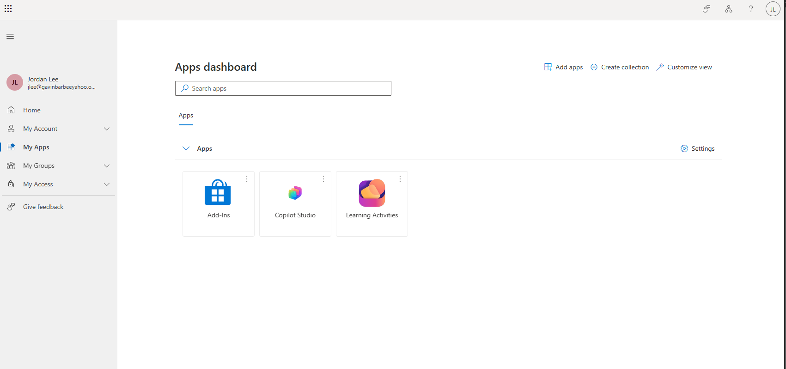

### 10. Leaver test: disable in AD, blocked in Entra

```powershell
Disable-ADAccount sortiz
```

AD recorded the change immediately (`Enabled: False`). The regular sync cycle hadn't picked it up after several minutes (see Troubleshooting), so I ran **Provision on demand** for `sortiz`, which pushed `AccountEnabled = False` to Entra ID. One change in AD removed cloud access, with no second manual step in Entra ID.

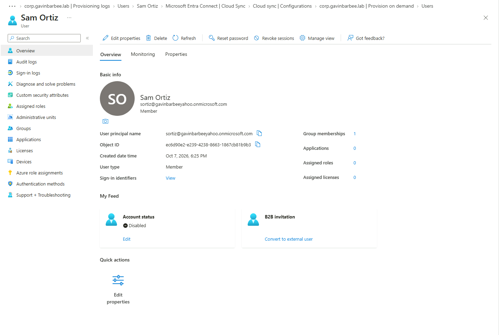

## Verification Checklist

- [x] VM has no public IP and RDP is only allowed from the Bastion subnet
- [x] `corp.gavinbarbee.lab` forest created with the database and SYSVOL on `F:`
- [x] OU structure, users, and groups match the table in step 3
- [x] Helpdesk can reset a password in `Corp\Users` and is denied on `adm-gavin`
- [x] `Get-ADUserResultantPasswordPolicy adm-gavin` returns `FGPP-Tier0-Admins`
- [x] `GPO-DC-Audit-Policy` is linked to the Domain Controllers OU and `auditpol` shows the settings
- [x] `adm-gavin` is in Protected Users
- [x] A deleted user was restored from the Recycle Bin with its group membership
- [x] Cloud Sync agent is Active and the configuration is scoped to two OUs
- [x] Synced users sign in with their AD password; `adm-gavin` and `svc-backup` are not in Entra ID
- [x] Disabling a user in AD disabled them in Entra ID

## Troubleshooting

| Issue | Cause | Fix |
| --- | --- | --- |
| Leaver test: `sortiz` still showed **Account enabled: Yes** in Entra ID several minutes after `Disable-ADAccount` | The provisioning logs showed an Update at 6:30:21 PM UTC that sent `AccountEnabled = True`. AD's `whenChanged` was 6:33:28 PM UTC, so that cycle ran three minutes before the disable, and the next cycle hadn't processed the change yet | Confirmed the AD state and timing with `Get-ADUser sortiz -Properties Enabled, whenChanged`, then ran **Provision on demand** for `sortiz`, which pushed `AccountEnabled = False` immediately. For an urgent termination, don't wait for the sync cycle: provision on demand and revoke sessions (`Revoke-MgUserSignInSession`) |

## Cleanup

Synced objects can't simply be deleted from Entra ID while sync is running, so I removed them through AD first:

1. Delete `jlee`, `sortiz`, `tkim`, and the three `GG-` groups in `Corp`, then wait for the next sync cycle and confirm they're gone from Entra ID.
2. Delete the Cloud Sync configuration in the Entra admin center.
3. Destroy the Azure resources:

```powershell
cd terraform
terraform destroy
```

4. Permanently delete the users from Deleted users in Entra ID.

## Key Takeaways

- For domain accounts, password and lockout policy only works at the domain level. Fine-grained password policies are the way to give admins stricter rules.
- Admin and service accounts should never sync to the cloud. Scoping sync by OU is a security decision, not just housekeeping.
- Password hash sync is the most resilient hybrid sign-in method: cloud sign-in keeps working even if on-premises AD is unreachable.
- AD is the source of authority for synced users, so changes happen in AD and flow to the cloud, including disabling a leaver.
- Delegation of control gives helpdesk exactly the rights it needs on exactly the OU it needs, without Domain Admin.
- The AD Recycle Bin restores a deleted user with its group memberships; re-creating the account by hand loses them.
- In production I'd run at least two Cloud Sync agents on member servers rather than the DC, and add a routable UPN suffix that matches a verified domain so users keep their real sign-in names.

---

*Built by Gavin Barbee · [github.com/gavinbarbee](https://github.com/gavinbarbee) · Time to complete: ~4 hours*